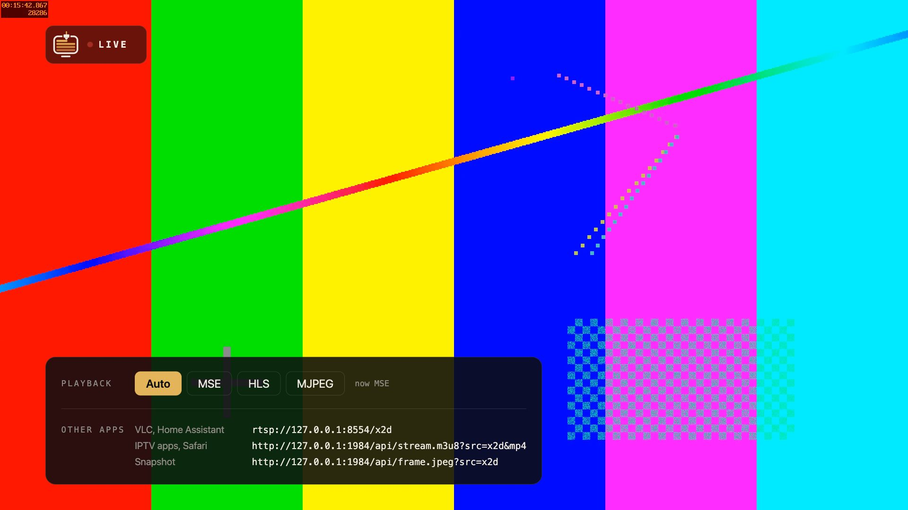
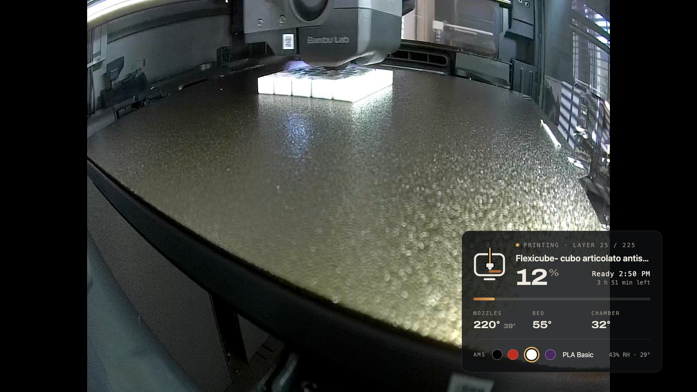
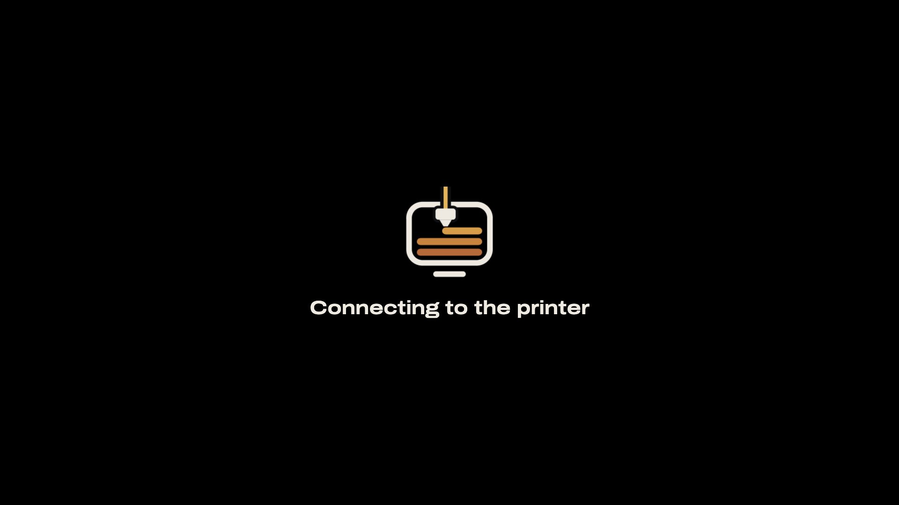
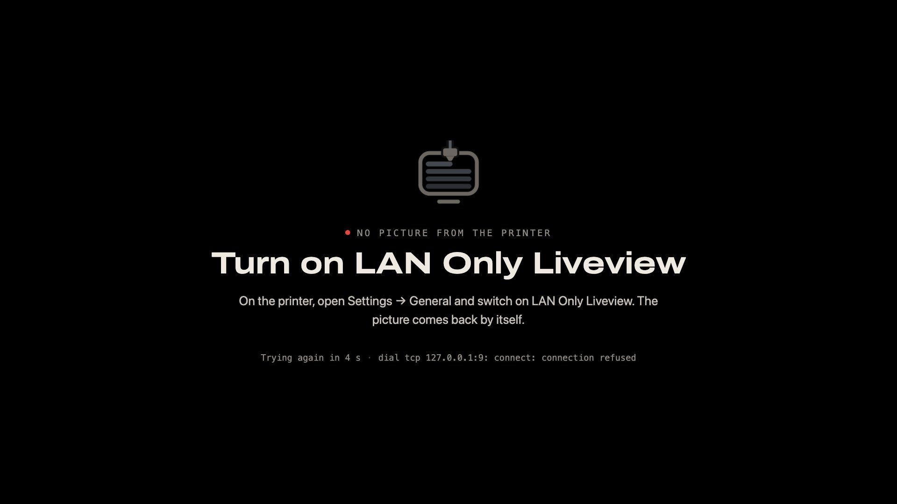

<div align="center">


### Your 3D printer's camera, live on every TV in the house.

Self-hosted · no cloud · no app · open source

</div>

<p align="center">
  
</p>

bambooTV runs on a small Linux machine in your home. It pulls the camera stream
from your printer **once** and serves it to every TV, laptop and phone on your
network: in the TV's web browser, or straight from the TV's list of
**connected devices**. While you watch, an optional background radio keeps you
company.

## What you get

- **Live 1080p in the TV's web browser**, with well under a second of delay.
- **Print info on screen**: progress, time left, layer, nozzle, bed and
  chamber temperatures, and the AMS spools in their real colours, as a card
  over the picture. The bambooTV logo prints itself along with your print.
  On DLNA TVs the same info is burned into the picture itself.
- **Appears on your TV by itself**: bambooTV announces itself on the network
  (DLNA), so Samsung and other DLNA-capable TVs list it under their connected
  devices, with its own icon and a live thumbnail of the print.
- **One connection to the printer**, however many screens are watching. It
  only connects while someone watches.
- **Background radio** (optional): US Top 40 by default, or any internet
  radio station you like, with an on/off switch.
- **Fixes itself**: printer off, network hiccup, firmware reboot — the picture
  comes back on its own, and a calm "no picture" screen tells you the one
  thing to fix. A TV that switched on hours later still finds bambooTV under
  its connected devices, and starting a print view after a quiet night takes
  one press, not a restart.
- **OLED-friendly**: on-screen elements fade out; the "no picture" screen
  drifts and dims.
- **Locked down**: only playback and print info are reachable on your network,
  bambooTV only reads from the printer, services run in a systemd sandbox, and
  the streaming engine is pinned and checksum-verified.
- **English and Dutch** on the TV.

<p align="center">
  
</p>

<p align="center">
  
  
</p>

## What you need

- A **Bambu Lab printer** with *LAN Only Liveview*. Verified on the **X2D**
  (firmware 01.02.00.00); X1-, H2- and P2-series printers use the same camera
  protocol (RTSPS on port 322).
- An always-on **Linux machine with systemd** on the same network: a Raspberry
  Pi 4/5, mini PC, NAS or home server. Docker works too.
- A **TV** with a web browser or DLNA support (Samsung, LG, Philips, Sony, …),
  or any computer, phone or tablet.

## Step 1 — Set up the printer

Do this on the printer's touchscreen:

1. **Find the IP address.** *Settings → Network (WLAN)*. Write it down, for
   example `192.168.1.50`.
2. **Find the access code.** On the same *Network* page: *Access Code* (eight
   letters/digits). Write it down.
3. **Switch on LAN Only Liveview.** *Settings → General → LAN Only Liveview →
   On*. This opens the local camera stream (port 322) that bambooTV uses.
   - Leave **LAN Only *Mode*** **off**: that one disconnects the printer from
     the cloud. LAN Only *Liveview* only adds the local stream, so Bambu Handy
     and Bambu Studio keep working, also away from home.
4. **Give the printer a fixed IP address** (recommended). In your router, look
   for "DHCP reservation" or "static lease" and reserve the printer's current
   address, so it never changes.

> If you ever generate a new access code on the printer, run the installer
> again with the new code (see [Change settings](#change-settings)).

## Step 2 — Install on your Linux machine

```bash
git clone https://github.com/jolynstudios/bambooTV.git
cd bambooTV
sudo ./install.sh --printer-ip 192.168.1.50 --with-dlna --radio on
```

No git on the machine? Download and unpack it instead:

```bash
curl -fsSL https://github.com/jolynstudios/bambooTV/archive/refs/heads/main.tar.gz | tar xz
cd bambooTV-main
sudo ./install.sh --printer-ip 192.168.1.50 --with-dlna --radio on
```

The installer asks for the access code (typing it there keeps it out of your
shell history), then:

1. checks that the printer's camera answers,
2. installs ffmpeg and python3 if they're missing,
3. downloads go2rtc 1.9.14 and verifies its checksum,
4. starts the services `bambu-tv` (streaming), `bambu-tv-status` (print
   info) and `bambu-tv-dlna` (TV discovery), and
5. prints the addresses to use.

Leave out `--with-dlna` if you only want the web page, and `--radio on` if you
don't want music. Everything can be changed later.

**Firewall?** If `ufw` or `firewalld` is active, the installer prints the exact
command that opens the ports (TCP 1984, 1985, 8554, 49499 and UDP 1900).

## Step 3 — Watch on your TV

**Option A — Connected devices** (Samsung, LG and other DLNA TVs)

1. Press **Source** (Samsung) or open the media player / *Home Dashboard*
   (LG).
2. Choose **bambooTV** under *Connected devices*.
3. Choose **X2D live**. The TV plays the picture, with the radio if it's on.

**Option B — The TV's web browser** (lowest delay, works on any smart TV)

1. Open the browser (Samsung: **Internet**).
2. Go to `http://<linux-machine-ip>:1984/`; the installer showed the exact
   address.
3. Add it to your bookmarks or the home screen.

Move the cursor or press **OK** on the remote to open the menu:

- **Playback** — *Auto* picks the best mode; choose *MJPEG* if an older TV
  shows no picture.
- **Sound** — browsers start videos muted, so press **On** once to hear the
  radio. Your choice is remembered, and from then on any press of OK brings
  the sound back.
- **Print info** — *Auto* shows the card when you open the page, every 10 %,
  when the print pauses or finishes, and whenever you press a button; in
  between, a small tag keeps the progress and the ready time. *Always* keeps
  the card up, *Off* hides it.

**Other devices:** any browser on your laptop, phone or tablet works the same
way. For apps, see [Other apps](#other-apps).

## Background radio

```bash
sudo ./install.sh --radio on                                     # default station
sudo ./install.sh --radio-url https://example.com/my-station.mp3 # your own station
sudo ./install.sh --radio off                                    # hard off: no audio track at all
```

- The default station is **181.FM Power 181 (US Top 40)**. Free stations play
  their own ads, which can be in your local language.
- Any MP3 or AAC internet radio stream works. Find stations and their stream
  URLs at [radio-browser.info](https://www.radio-browser.info): open a station
  and copy its *stream URL*.
- The radio only plays while someone watches, and the picture keeps running
  if the station is down.

## Change settings

All settings live in `/etc/bambu-tv/bambu-tv.env`. Either run the installer
again with new options (it keeps everything else), or edit the file and
restart:

```bash
sudo nano /etc/bambu-tv/bambu-tv.env
sudo systemctl restart bambu-tv bambu-tv-dlna
```

| Installer option | Setting | What it does | Default |
|---|---|---|---|
| `--printer-ip IP` | `PRINTER_IP` | printer's IP address | — |
| `--access-code CODE` | `ACCESS_CODE` | printer's LAN access code | asked |
| `--http-port PORT` | `HTTP_PORT` | port of the TV page | `1984` |
| `--rtsp-port PORT` | `RTSP_PORT` | RTSP port for other apps | `8554` |
| `--with-dlna` / `--without-dlna` | — | list on TVs' connected devices | off |
| `--lan-ip IP` | `DLNA_LAN_IP` | fixed address to advertise via DLNA | automatic |
| `--radio on\|off` | — | background radio | off |
| `--radio-url URL` | `RADIO_URL` | radio station stream | 181.FM Power 181 |
| `--status on\|off` | — | print info on the TV page | on |
| `--status-port PORT` | `STATUS_PORT` | port of the print info service | `1985` |
| `--overlay on\|off` | — | burn the print progress into the DLNA picture (off saves CPU on a Raspberry Pi) | on |
| — | `RTSP_USER`, `RTSP_PASS` | require a login for RTSP apps | open |

## Other apps

| App | Address |
|---|---|
| VLC, Home Assistant, NVRs (RTSP, camera only) | `rtsp://<linux-machine-ip>:8554/x2d` |
| IPTV apps, Safari, VLC (HLS, with the radio when it's on) | `http://<linux-machine-ip>:1984/api/stream.m3u8?src=tv&mp4` |
| MJPEG (old browsers, dashboards) | `http://<linux-machine-ip>:1984/api/stream.mjpeg?src=x2d_mjpeg` |
| Snapshot (JPEG) | `http://<linux-machine-ip>:1984/api/frame.jpeg?src=x2d` |
| Print status (JSON: progress, temperatures, AMS) | `http://<linux-machine-ip>:1985/status.json` |

TV page options: `?mode=mse|hls|mjpeg` forces a playback mode, `?lang=nl`
switches to Dutch, `?statusport=PORT` follows a changed print info port.

## Docker

```bash
cp bambu-tv.env.example bambu-tv.env   # fill in PRINTER_IP and ACCESS_CODE
docker compose up -d                   # TV page on port 1984, print info on 1985
docker compose --profile dlna up -d    # plus TV discovery (DLNA)
```

For the radio, set `RADIO_URL` in `bambu-tv.env` and uncomment the
`radio.yaml` line in `compose.yaml`.

## Update and uninstall

```bash
cd bambooTV && git pull && sudo ./install.sh   # update, keeps your settings
                                               # (no git: download again as in step 2)
sudo ./install.sh --uninstall                  # remove (settings stay)
sudo ./install.sh --uninstall --purge          # remove everything
```

## Troubleshooting

| You see | Do this |
|---|---|
| "Turn on LAN Only Liveview" | On the printer: *Settings → General → LAN Only Liveview → On*. The picture returns by itself. |
| "The printer isn't answering" | Is the printer on and on the network? Did its IP change? Re-run the installer with `--printer-ip`. |
| "The printer rejected the access code" | Copy the code from *Settings → Network* and re-run the installer. |
| bambooTV isn't under *Connected devices* | Install with `--with-dlna`. With a firewall, allow UDP 1900 and TCP 49499. Make sure the TV and the Linux machine are on the same network (not a guest network). |
| The page loads but stays black | Open the menu and choose **MJPEG**. |
| No sound in the browser | Open the menu and press **Sound → On**. Is the radio switched on (`--radio on`)? |
| No print info on the TV page | Open the menu: the *Print info* row says what's wrong, for example a rejected access code. Switched off? `sudo ./install.sh --status on`. With a firewall, allow TCP 1985. |
| bambooTV vanished from *Connected devices*, or the item no longer plays | TVs forget a device when they miss its announcements; bambooTV reintroduces itself every minute, so the entry comes back within two minutes (or after switching the TV off and on). Still nothing? `sudo systemctl restart bambu-tv-dlna`. |

Logs: `journalctl -u bambu-tv -f`, `journalctl -u bambu-tv-status -f` and
`journalctl -u bambu-tv-dlna -f`.
Full check from any machine: `dev/smoke-test.sh http://<linux-machine-ip>:1984`.

## Security

The picture is open on your **home network** on purpose: a TV can't log in.
Everything else is closed: go2rtc's admin API, config editor and scripting
features are not exposed, and all services run as throwaway users in a
read-only systemd sandbox. The print info only listens to the printer's status
feed; it never sends the printer a command. The access code never appears in
logs, in the print info or in the DLNA service. Don't expose these ports to the internet; for viewing away from
home, use a VPN such as WireGuard or Tailscale. Details: [docs/TECHNICAL.md](docs/TECHNICAL.md).

## Testing without a printer

```bash
dev/fake-printer.sh a1b2c3d4            # terminal 1: simulated X2D camera and status feed (needs mediamtx + ffmpeg)
PRINTER_IP=127.0.0.1 ACCESS_CODE=a1b2c3d4 WEB_DIR=$PWD/web \
  go2rtc -config config/go2rtc.yaml     # terminal 2
PRINTER_IP=127.0.0.1 ACCESS_CODE=a1b2c3d4 \
  python3 status/bambu_tv_status.py     # terminal 3
dev/smoke-test.sh http://127.0.0.1:1984 # terminal 4: end-to-end check
```

## Credits

Built on [go2rtc](https://github.com/AlexxIT/go2rtc) (MIT). The print info
reads the printer's local status feed (MQTT), the one Bambu Studio uses in LAN
mode. The TV page uses
the [Archivo](https://github.com/Omnibus-Type/Archivo) typeface (OFL). See
[THIRD-PARTY-NOTICES.md](THIRD-PARTY-NOTICES.md).

bambooTV is an independent project, not affiliated with or endorsed by Bambu
Lab. Printer names are used only to describe compatibility.

## License

[MIT](LICENSE) © Jolyn Studios and bambooTV contributors
